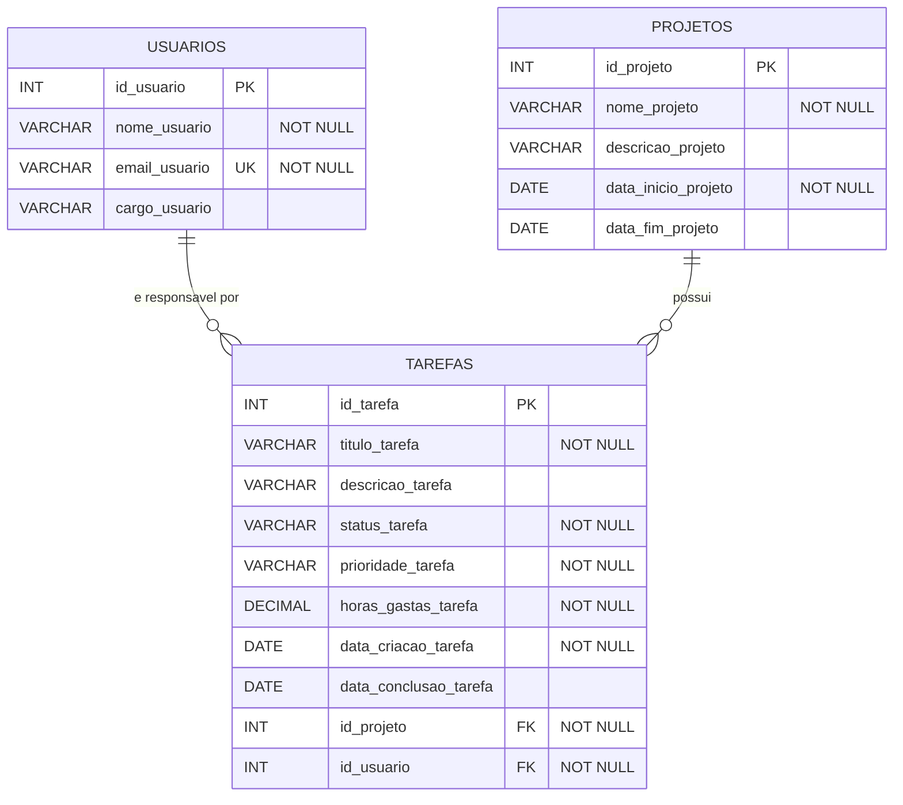

## Cardinalidades
- **PROJETOS 1 : N TAREFAS** — um projeto tem zero ou mais tarefas; cada tarefa pertence a exatamente um projeto.
- **USUARIOS 1 : N TAREFAS** — um usuário é responsável por zero ou mais tarefas; cada tarefa tem exatamente um responsável.

## Restrições
| Tabela | Restrição |
|---|---|
| USUARIOS | `email_usuario` único |
| PROJETOS | `data_fim_projeto >= data_inicio_projeto` |
| TAREFAS | `status_tarefa` em (PENDENTE, EM_ANDAMENTO, CONCLUIDA) |
| TAREFAS | `prioridade_tarefa` em (BAIXA, MEDIA, ALTA) |
| TAREFAS | `horas_gastas_tarefa >= 0` |
| TAREFAS | FKs com `ON DELETE RESTRICT` (a aplicação pergunta se deve excluir os filhos) |
